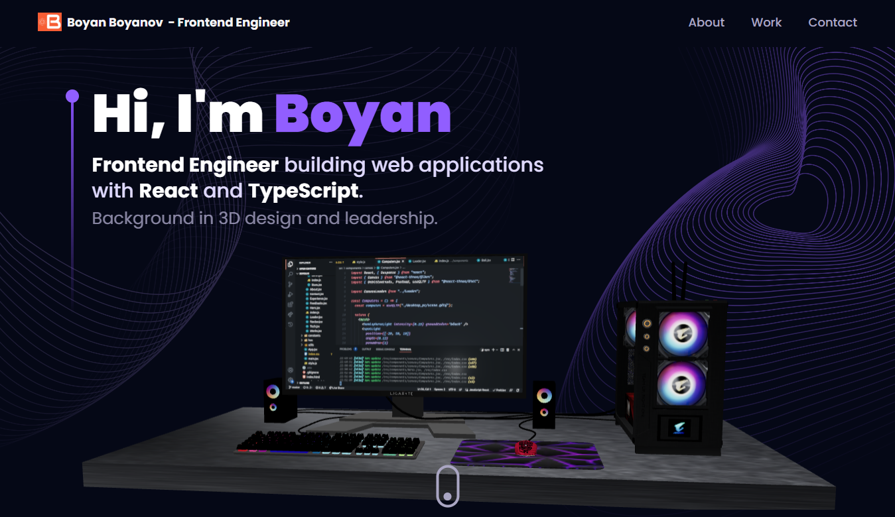

# Boyan Boyanov · Portfolio

Personal portfolio of a Frontend Engineer, built with React and interactive 3D scenes in Three.js.



## Highlights
- **Interactive 3D:** desk scene in the hero, animated globe and 3D tech icons, built with React Three Fiber and Drei
- **Experience timeline:** reverse-chronological work history with detail modals
- **Contact form:** sends email directly from the browser via EmailJS
- **Animations:** scroll-triggered transitions with Framer Motion and tilt effects on cards
- **Responsive:** layout adapts from desktop to mobile

## Tech stack
React 19 · Vite · Three.js · React Three Fiber · Drei · Tailwind CSS 4 · Framer Motion · React Router · EmailJS

## Run locally
```bash
npm install
npm run dev
```

## Updating the CV
The CV page (`/cv`) renders the PDF directly, so the PDF is the only file to change.

1. Export the CV from Canva as PDF.
2. Replace `public/cv/Boyan_Boyanov_Frontend_Engineer_CV.pdf` (keep the exact file name).
3. Commit and push; the site redeploys and the cache-busting version updates automatically.
